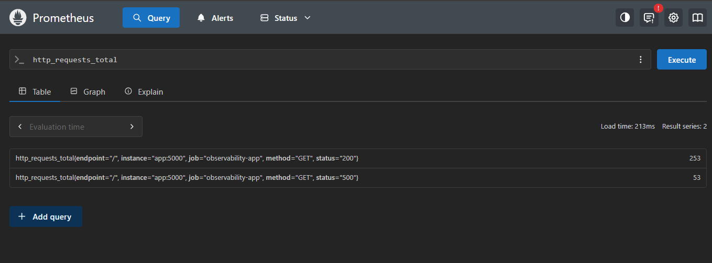
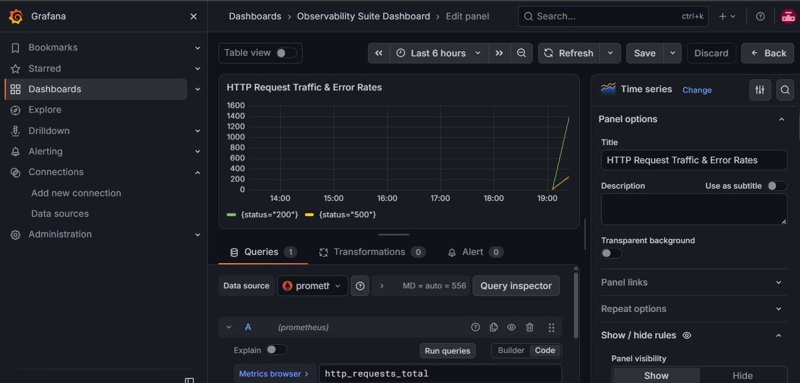

# Elevate Labs DevOps Internship - Project 3: Observability Suite

## 🚀 Project Overview
This project implements an enterprise-grade, full-stack Observability and Monitoring pipeline for containerized microservices. It aggregates metrics, logs, and traces using industry-standard open-source tools deployed via Docker Compose and managed in a cloud-based development environment (GitHub Codespaces).

---

## 🛠️ Tech Stack & Tools
* **Containerization & Orchestration:** Docker, Docker Compose
* **Metrics & Monitoring:** Prometheus
* **Visualization:** Grafana
* **Logging:** Grafana Loki
* **Distributed Tracing:** Jaeger
* **Application Stack:** Python, Flask, `prometheus_client`
* **Environment:** GitHub Codespaces

---

## 🏗️ Architecture & Execution Steps

1. **Custom Python Flask Microservice:**
   - Developed a Flask application exposing `/` (with simulated 15% HTTP 500 error rates) and `/metrics` endpoint using `prometheus_client`.
2. **Prometheus Scraping Configuration:**
   - Configured `prometheus.yml` to scrape metrics from the Flask app every 5 seconds.
3. **Grafana Visualization:**
   - Connected Prometheus as a data source in Grafana (`http://prometheus:9090`) and created custom time-series panels for request rates and error tracking.
4. **Synthetic Load Generation:**
   - Simulated continuous HTTP traffic using a background `curl` loop to generate live metrics spikes.

---

## 📸 Execution Proofs & Screenshots

### 1. Prometheus Metrics Scraping (`ss1`)
*Verifying live metric collection for successful HTTP 200 and error 500 responses:*

### 2. Grafana Dashboard Visualization (`ss2`)
*Real-time monitoring panel displaying request traffic and error rate spikes:*

---

## 💡 Conclusion
Successfully deployed and verified a complete observability pipeline, enabling real-time metrics collection, error tracking, and visual monitoring for microservices architecture.
